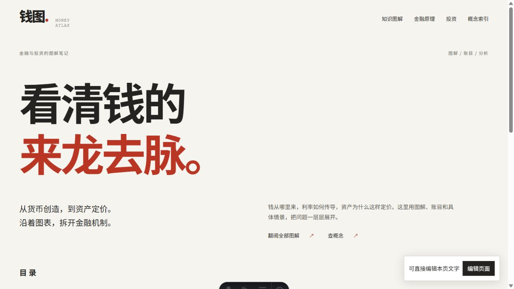
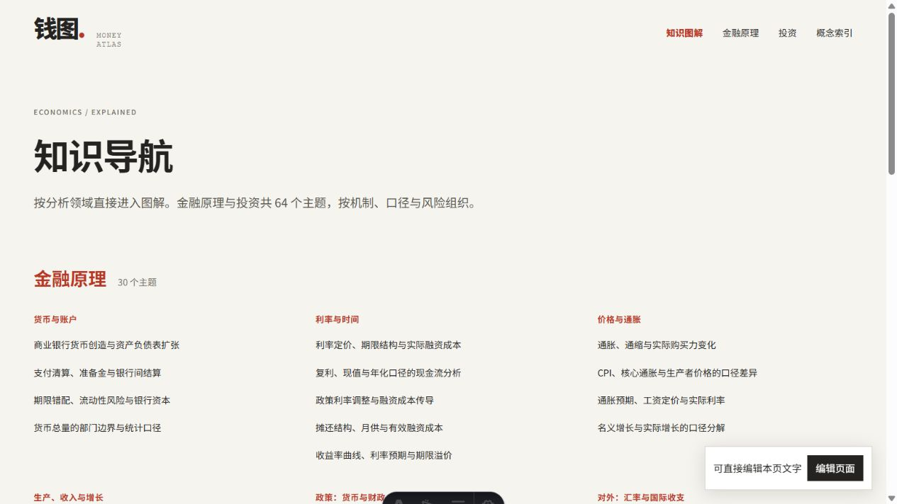
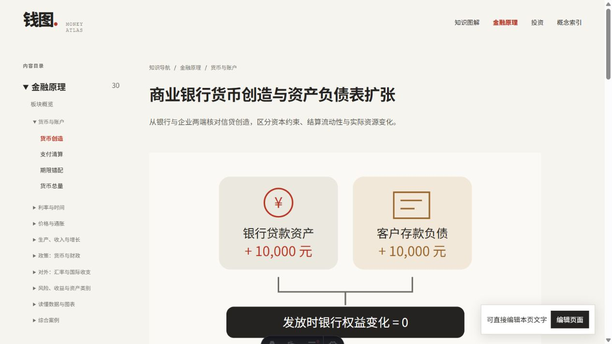
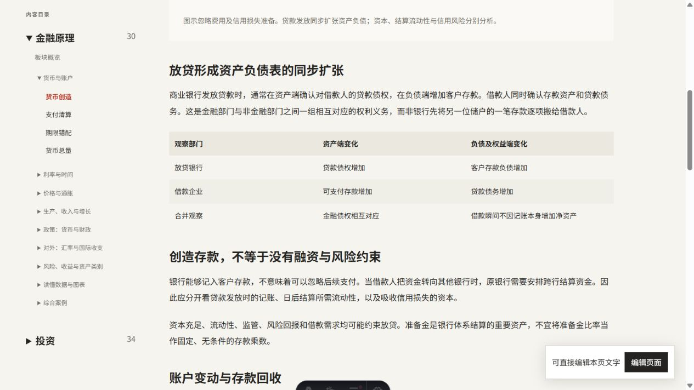

# 钱图 PC 阅读体验审查

审查日期：2026-11-16。使用 Product Design 的审查流程，在当前本地站点实际完成“首页 → 知识导航 → 货币正文 → 下滚阅读”，捕获并逐张检查本次截图。观察视口约 1265 × 712，仅评估 PC，不涉及手机适配。本次没有改动页面。

## 结论

黑体、朱红和开放版面已有一致方向。当前最需要处理的是信息比例与阅读密度：大标题和图解占据主要空间，目录、说明和表格文字相对偏小。下一轮应先做货币正文页样板，再把确定的字号和间距应用到其他页面。

保留已确定的约束：PC 优先、黑体、无装饰性横竖线、悬停只改变文字、保留网页编辑保存功能。

## 1. 首页：入口可用，主要内容出现较晚

健康度：可用，视觉比例需要调整。

- 实际点击“翻阅全部图解”成功进入知识导航。
- 主标题辨识度高，但在本次窗口下，目录只在视口底部露出标题。首访用户需要滚动才能看到两个内容板块。
- 标题右侧留白较大，正文介绍和阅读入口在下方分散，主次关系可以更集中。
- 小字说明和链接较小，建议适度放大；保留字重差异，不以背景高亮建立交互。

建议：适度缩小主标题与上下留白，把实际内容入口带入第一屏。不恢复已移除的银行信用卡片。

## 2. 知识导航：结构清楚，标题较长且字号偏小

健康度：结构清楚，需要改善扫描阅读。

- 金融原理、分组、主题三层关系可辨，已无逐条分隔线。
- 三列主题均为较长完整标题，字号偏小，连续扫描需要较多注意力。
- 页面介绍与内容目录之间留白较大；可以把这部分空间还给主题列表。
- 本次实际点击货币主题成功进入正文。

建议：先统一分组与主题的字号、行距、组间距，主题可使用现有短标签辅助扫描，完整标题仍应可访问。是否改目录文案需单独确认。

## 3. 货币正文首屏：结构稳定，图解占屏较多

健康度：可读，图文比例需要收紧。

- 侧栏与正文分区稳定，当前位置使用文字颜色区分。
- 第一张图占据首屏大部分高度，图注和第一节说明需要继续滚动才能看到。
- 页面标题、摘要、图解之间的留白叠加，延后了实质阅读。
- 本地编辑浮层出现在图解右下方，视觉上与金融内容竞争；这是编辑环境的观察，不代表发布版也有此浮层。

建议：控制图解最大尺寸，确保常见 PC 窗口中可同时看到图、图注和下一节入口。阅读状态将编辑入口收为简短按钮，进入编辑后再展示完整工具。

## 4. 下滚阅读：无边框表格有效，辅助文字偏小

健康度：基本良好，长文阅读层级可统一。

- 标题、段落与账目表的顺序自然。表格用浅色行区分，无需恢复网格线。
- 表格、侧栏和图注的文字明显小于正文，阅读时视线需要反复适应。
- 正文行较长，章节标题字重较强，需要用稳定的宽度和字号比例平衡。
- 左侧全站目录对切换主题有帮助；当前没有本文小节导航，长文内定位需要滚动查找。

建议：先统一正文、表格、图注和侧栏字号；本文小节导航作为后续可选项，不直接新增功能。

## 建议的 PC 样板基线

以下是下一轮验证用的建议值，尚未写入实现：

| 元素 | 建议基线 |
| --- | --- |
| 验证窗口 | 1440 × 900 与 1280 × 800 |
| 正文宽度 | 约 760–800 px |
| 侧栏 | 约 200–220 px |
| 正文 | 16 px，行高约 1.9 |
| 主题目录 | 14–15 px |
| 表格与图注 | 14 px 左右 |
| 页面标题 | 32–36 px，按长标题换行验证 |
| 小节标题 | 21–24 px |
| 悬停与当前项 | 文字颜色和字重，不添加背景或分隔线 |

## 验证范围与限制

本次确认了首页入口和主题入口的实际跳转，并观察了正文下滚状态。截图显示的“小字风险”和阅读负担属于视觉判断，未进行完整的对比度、键盘、读屏或缩放测试，也未重新测试保存功能；不能据此声称完整无障碍合规或全部功能通过。

下一步：以货币正文页建立一个 PC 样板，确认图文比例后再统一全站，避免继续逐页叠加样式覆盖。
